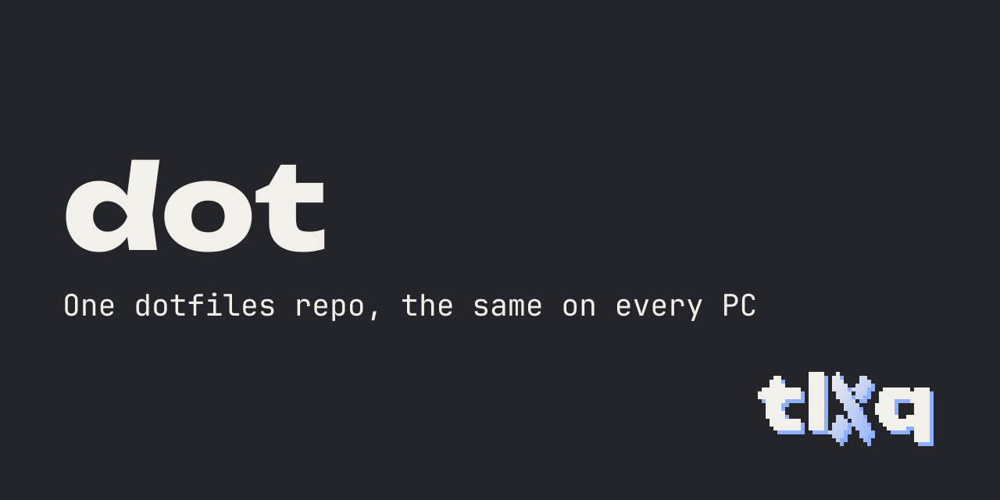
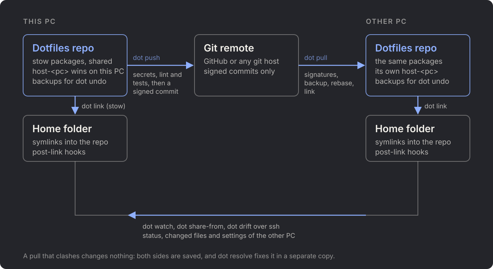

<p align="center"></p>

A command-line tool for people who keep their dotfiles in one git repo of
[GNU Stow](https://www.gnu.org/software/stow/) packages and use more than one Linux PC. `dot push` on one PC,
`dot pull` on the other, and both are the same again, without a half-done rebase or a stranger's commit.

Checks run on my own PC before every merge: `mise run check`.

<!-- Terminal recording goes here: docs/assets/push-pull.gif (not made yet). -->

## Why it exists

I use a desktop and a laptop every day. Plain `git pull` in a dotfiles repo went wrong in small ways: a rebase
stopped halfway and left conflict markers in my live config, a file I had edited on both PCs got lost, and nothing
checked who made the commits I was pulling into my shell config. `dot` is the set of rules I wanted instead:

- **Nothing changes unless it all works.** A pull checks every incoming commit, saves a backup, and if the rebase
  clashes it puts the repo back where it was. `dot undo` goes back to any of the last 20 backups.
- **Only commits signed by my own keys come in.** The trusted keys live in the repo itself.
- **Nothing secret goes out.** `dot push` runs gitleaks, ShellCheck, a JSON and Lua check and the repo's own tests
  before it commits.
- **Each PC can have its own version of a file.** A package named `host-<hostname>` is linked only on that PC and
  wins over the shared one.

## What was hard

Trusting what `dot pull` brings in. Git can check signatures, but the list of trusted keys has to come from
somewhere. If it came from the incoming commits, anyone who could push to the remote could add their own key and
then sign with it. So `dot pull` reads `allowed_signers` as it is committed at this PC's `HEAD`, before it applies
anything, and stops if any incoming commit isn't signed by one of those keys. A new key has to arrive in a commit
signed by a key that is already trusted. There is a test for exactly that case.

The second problem was the clash. A pull that stops halfway leaves conflict markers in files the desktop is
reading right now. `dot pull` never leaves the repo like that: it saves both sides of each file, undoes the rebase
and says what clashed. `dot resolve` then replays the pull in a separate git worktree, so the live config never
sees a conflict marker, and can hand it to [Claude Code](https://claude.com/claude-code) with rules (only those
files, keep per-PC settings apart, explain the choice). `dot resolve --accept` only takes the fix when the rebase is
finished, no file has conflict markers, every new commit is signed by a trusted key and `dot check` passes.

## How it fits together

<p align="center"></p>

## Commands

| Command | What it does |
|---|---|
| `dot` | Fetch and show the sync state |
| `dot push [-m <msg>] [-- <path>…]` | Check, commit (signed) and push everything, or only those paths |
| `dot pull` | Check signatures, save a backup, rebase, link, run hooks |
| `dot check [--all]` | The checks `dot push` runs, on what's outgoing or the whole repo |
| `dot diff` | Everything `dot push` would share |
| `dot undo [<n>]` | List the backups, or go back to one |
| `dot resolve [--show\|--accept\|--drop]` | Solve a stopped pull in a separate copy |
| `dot link [pkg…]` · `dot unlink <pkg>…` | Stow packages and run `hooks/post-link.d/*.sh` |
| `dot add <pkg> <path>` | Move a file from your home folder into a package and link it |
| `dot keep-here <path>` | Turn a shared file into this PC's own copy |
| `dot watch` | Ask the other PCs for their state over ssh (a systemd timer runs it) |
| `dot share-from [<pc>]` | Show another PC's changes, then run its `dot pull` and `dot push` there |
| `dot pick <path>… mine\|theirs` | Both PCs changed a file: keep one version on both |
| `dot revert <commit>` | Take one shared change back on both PCs |
| `dot drift` | Settings on a watch list that differ between the PCs, and sort them |
| `dot start push\|pull` · `dot stop` · `dot job` | Run a push or pull in the background and follow its steps |
| `dot status --json` | The state as JSON, no network, for a status bar |
| `dot doctor` | Read-only health check |

`dot help` lists every option.

## Stack

Bash · GNU Stow · git with SSH commit signing · jq · systemd · bats tests · ShellCheck · gitleaks

## Run it

Linux with GNU tools (tested on Arch). You need `bash`, `git`, `stow` and `jq`. Optional: `gitleaks` and
`shellcheck` for the checks, `bats` for tests in your dotfiles repo, `notify-send` for background jobs, `claude` for
`dot resolve`.

```bash
git clone https://github.com/tlxq/dot.git
install -m 755 dot/dot ~/.local/bin/dot
```

Install it at `~/.local/bin/dot` on every PC: `dot watch` and `dot share-from` run it there over ssh.

### Try it without touching your home folder

`DOT_TARGET` sends the links to another folder.

```bash
mkdir -p /tmp/dot-demo/repo/bash /tmp/dot-demo/home && cd /tmp/dot-demo/repo
git init -q && echo 'alias ll="ls -l"' > bash/.bashrc
DOTFILES=/tmp/dot-demo/repo DOT_TARGET=/tmp/dot-demo/home dot link
ls -la /tmp/dot-demo/home       # .bashrc -> ../repo/bash/.bashrc
DOTFILES=/tmp/dot-demo/repo DOT_TARGET=/tmp/dot-demo/home dot doctor --offline
```

`dot doctor` names what is still missing: an upstream, and the signing keys from step 1 below.

### Your own dotfiles

The repo lives at `~/.dotfiles` (or set `DOTFILES`). Every top-level folder is a stow package that mirrors your
home folder, so `bash/.bashrc` becomes `~/.bashrc`. `hooks/`, `system/`, `tests/` and the names in `.dotignore`
are not packages.

1. Turn on SSH commit signing in the repo and commit your public keys as `git/.config/git/allowed_signers`, one
   line per PC (`you@example.com ssh-ed25519 AAAA…`). Without it `dot pull` refuses every incoming commit.
   Another path: set `DOT_SIGNERS`.
   ```bash
   git -C ~/.dotfiles config gpg.format ssh
   git -C ~/.dotfiles config user.signingkey ~/.ssh/id_ed25519.pub
   git -C ~/.dotfiles config commit.gpgsign true
   ```
2. `dot link`, then `dot doctor`.
3. For `dot watch`, `dot share-from`, `dot pick mine` and `dot drift`, list your PCs in `system/hosts/pcs.txt`:
   one line per PC, its hostname (as in `/etc/hostname`) and its ssh alias.
   ```
   desk    desk.lan
   laptop  laptop.lan
   ```
4. Optional: `system/drift/watch.txt` lists files (relative to your home folder) to compare between the PCs.
   `.gitattributes` can give a file a merge rule so it never stops a pull: `merge=union`, or `merge=lazylock` for
   Neovim's `lazy-lock.json`.
5. Optional: the timer that runs `dot watch` every 3 minutes.
   ```bash
   cp dot/systemd/dot-watch.* ~/.config/systemd/user/
   systemctl --user enable --now dot-watch.timer
   ```

Then: `dot push` before you leave a PC, `dot pull` when you sit down at the other.

### Checks

```bash
mise install
mise run check
```

ShellCheck and the 92 bats tests. Each test makes its own remote, two clones, git config and signing key in a
temp folder; nothing outside it is touched.

## Where it comes from

This is the general part of the `dot` I use every day. My own copy has more on top that only makes sense on my
PCs (a status bar plugin, auto sync, a list of my code projects); that part stays out of this repo.

## Licence

[MIT](LICENSE)
